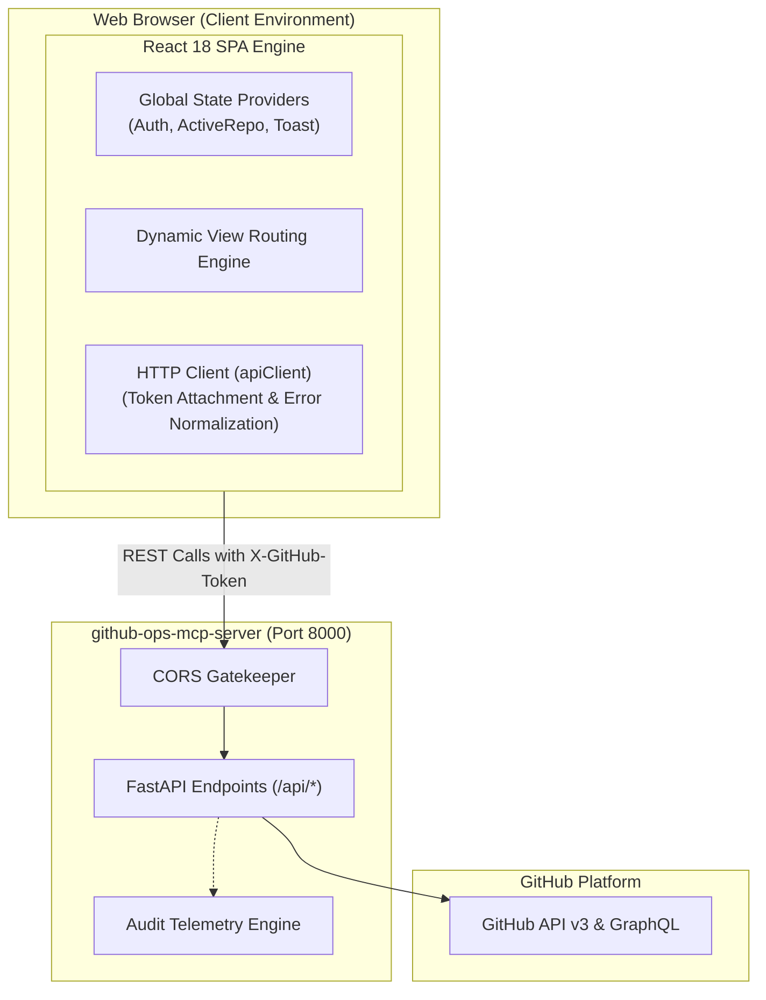
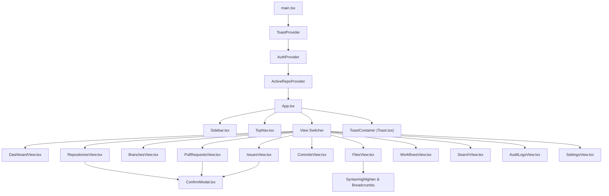
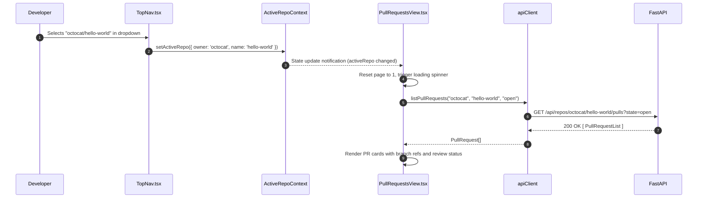
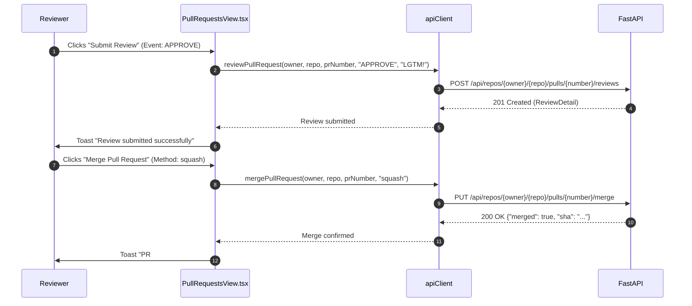

# GitHub Operations Management UI (`github-ops-ui`)

A modern, responsive dashboard interface for performing and managing GitHub operations backed by the **GitHub Operations FastAPI and Model Context Protocol (MCP) server**.

[](https://github.com/ravi-kundu7284/github-ops-ui/actions)
[](https://react.dev)
[](https://www.typescriptlang.org/)
[](https://vitejs.dev/)
[](https://tailwindcss.com/)
[](LICENSE)

---

## 📑 Table of Contents

1. [High-Level Design (HLD)](#high-level-design-hld)
   - [System Context & Objectives](#system-context--objectives)
   - [Presentation Architecture Diagram](#presentation-architecture-diagram)
   - [Zero-Knowledge Token Security Model](#zero-knowledge-token-security-model)
   - [Reactive State Flow & Context Synchronization](#reactive-state-flow--context-synchronization)
2. [Low-Level Design (LLD)](#low-level-design-lld)
   - [Component Hierarchy & Tree Architecture](#component-hierarchy--tree-architecture)
   - [State Management & Context Specifications](#state-management--context-specifications)
   - [HTTP Service Layer (`apiClient`)](#http-service-layer-apiclient)
   - [Safety Confirmation State Machine](#safety-confirmation-state-machine)
   - [File Explorer & Code Diff Engine](#file-explorer--code-diff-engine)
   - [Sequence Diagrams](#sequence-diagrams)
3. [Comprehensive Views & Feature Catalog](#comprehensive-views--feature-catalog)
4. [Prerequisites & Local Setup](#prerequisites--local-setup)
5. [Testing & Quality Verification](#testing--quality-verification)
6. [Containerization & Static Deployment](#containerization--static-deployment)
7. [CI/CD Pipeline](#cicd-pipeline)

---

## High-Level Design (HLD)

### System Context & Objectives

`github-ops-ui` is a single-page React application built with TypeScript, Vite, and Tailwind CSS. It communicates directly with the `github-ops-mcp-server` over HTTPS/REST to provide developers, team leads, and DevOps engineers with an intuitive web control center for GitHub repositories, branches, pull requests, issues, actions workflows, commits, files, and audit records.



### Presentation Architecture Diagram

```mermaid
flowchart LR
    subgraph RootProviders["Context Provider Shell"]
        TP["ToastProvider"]
        AP["AuthProvider"]
        RP["ActiveRepoProvider"]
    end

    subgraph AppShell["Application Shell (App.tsx)"]
        SidebarComp["Sidebar Navigation (11 Items)"]
        TopNavComp["Top Navigation (Repo Dropdown, Search, Profile)"]
        MainContent["Dynamic View Container"]
    end

    subgraph Views["11 Domain Views"]
        V1["Dashboard"]
        V2["Repositories"]
        V3["Branches"]
        V4["Pull Requests"]
        V5["Issues"]
        V6["Commits"]
        V7["Files"]
        V8["Workflows"]
        V9["Search"]
        V10["Audit Logs"]
        V11["Settings"]
    end

    TP --> AP
    AP --> RP
    RP --> AppShell
    AppShell --> SidebarComp
    AppShell --> TopNavComp
    AppShell --> MainContent
    MainContent --> Views
```



### Zero-Knowledge Token Security Model

1. **No Disk Persistence:** GitHub Personal Access Tokens (PATs) are never saved to unencrypted localStorage, cookies, or IndexedDB unless the user explicitly saves it for development convenience in session storage.
2. **Ephemeral Header Transmission:** All API operations transmit the token through standard HTTP headers (`X-GitHub-Token` and `Authorization: Bearer`).
3. **No Credential Echoing:** The UI never outputs token characters in rendered DOM elements outside masked password inputs.

### Reactive State Flow & Context Synchronization

- **`ActiveRepoContext` Propagation:** Selecting an active repository in either the `TopNav` dropdown or the `RepositoriesView` updates the global repository context. This immediately propagates the current repository owner and name to all downstream views (`BranchesView`, `PullRequestsView`, `IssuesView`, `CommitsView`, `FilesView`, `WorkflowsView`).
- **Global Toast Notification Bus:** Dispatched from any view or service layer to provide non-blocking visual feedback on operations (success, error, warning, info).

---

## Low-Level Design (LLD)

### Component Hierarchy & Tree Architecture



### State Management & Context Specifications

#### 1. `AuthContext.tsx`
- **Responsibilities:**
  - Manages GitHub Personal Access Token (`token: string`).
  - Manages authenticated GitHub user profile (`user: GitHubUser | null`).
  - Tracks backend API connectivity status (`isConnected: boolean`).
  - Regularly polls GitHub rate-limit status (`rateLimit: RateLimitInfo | null`).
- **Interface:**
  ```typescript
  interface AuthContextType {
    token: string;
    setToken: (token: string) => void;
    user: GitHubUser | null;
    rateLimit: RateLimitInfo | null;
    isConnected: boolean;
    refreshUser: () => Promise<void>;
  }
  ```

#### 2. `ActiveRepoContext.tsx`
- **Responsibilities:**
  - Stores currently selected repository across views (`activeRepo: { owner: string; name: string } | null`).
  - Exposes `setActiveRepo(repo)` for selection by `TopNav` or `RepositoriesView`.
- **Interface:**
  ```typescript
  interface ActiveRepoContextType {
    activeRepo: { owner: string; name: string } | null;
    setActiveRepo: (repo: { owner: string; name: string } | null) => void;
  }
  ```

#### 3. `ToastContext.tsx`
- **Responsibilities:**
  - Manages alert toast queue with auto-dismiss timer (default: 4000ms).
- **Interface:**
  ```typescript
  interface ToastContextType {
    showToast: (message: string, type?: 'success' | 'error' | 'warning' | 'info') => void;
  }
  ```

### HTTP Service Layer (`apiClient`)

Located in `src/services/api.ts`:
- **Dynamic Base URL:** Configurable at runtime via `localStorage` override or fallback to `VITE_API_BASE_URL` (default `http://localhost:8000`).
- **Header Injection:** Intercepts every outgoing request and injects `X-GitHub-Token: ${token}` and `Authorization: Bearer ${token}`.
- **Unified Error Handling:** Parses backend structured error payloads into typed `ApiError` instances containing message, HTTP status code, and validation details.

### Safety Confirmation State Machine

Critical destructive operations (e.g. deleting a repository) use `ConfirmModal.tsx`:
1. Modal presents a warning alert with the target resource name.
2. User must type the **exact match** challenge string into an input field.
3. The confirmation button remains strictly disabled until `inputString === challengeString`.
4. Upon confirmation, the backend endpoint is invoked with the verification parameter (`confirm=repo_name`).

### File Explorer & Code Diff Engine

- **Tree & Breadcrumb Navigation (`FilesView.tsx`):** Parses repository content paths, allowing hierarchical directory traversal and breadcrumb navigation.
- **Base64 Decoding & Editing:** Automatic Base64 decoding of GitHub API content payloads into editable strings and Base64 re-encoding upon commit creation.
- **Unified Diff Patch Inspector (`CommitsView.tsx`):** Parses Git patch diffs, formatting added lines in green (`+`) and deleted lines in red (`-`).

### Sequence Diagrams

#### 1. Repository Selection & Cascading View Refresh



#### 2. PR Review Submission & Merge Workflow



---

## Comprehensive Views & Feature Catalog

| View Name | Primary Features | Destructive Safeguards |
| :--- | :--- | :---: |
| **Dashboard** | Profile summary, repository count, live rate-limit meter, MCP backend health monitor, quick-action shortcuts | No |
| **Repositories** | List, search, filter by visibility (`all`, `public`, `private`), create repository, update settings, delete repository | **Challenge validation modal** |
| **Branches** | Branch list with latest commit SHA, protected badges, create new branch from source ref | No |
| **Pull Requests** | PR list by state (`open`, `closed`), head/base branch badges, create PR, submit review (`APPROVE`, `REQUEST_CHANGES`), merge PR | **Confirmation on merge** |
| **Issues** | Issue tracker with labels and assignees, create new issue, close issue with resolution comment | **Confirmation on close** |
| **Commits** | Chronological commit history, author avatar, SHA copy button, commit detail diff inspector with additions/deletions stats | No |
| **Files** | Interactive directory tree with breadcrumbs, syntax-highlighted file viewer, inline editor with commit authoring | No |
| **Workflows** | GitHub Actions workflows, execution runs, status badges (`success`, `failure`), run logs inspector and download | No |
| **Global Search** | Unified search across repositories, issues, pull requests, commits, and code (`Ctrl+K` shortcut) | No |
| **Audit Logs** | Real-time table of operations dispatched via REST and MCP, filterable by channel and status, parameter inspector | **Clear log confirmation** |
| **Settings** | Backend URL override, GitHub Token management (stored in browser memory), MCP client configuration generator | No |

---

## Prerequisites & Local Setup

### 1. Prerequisites
- **Node.js:** v18.0.0+ or v20.0.0+
- **npm:** v9.0.0+

### 2. Installation
```bash
# Clone the repository
git clone https://github.com/ravi-kundu7284/github-ops-ui.git
cd github-ops-ui

# Install dependencies
npm install
```

### 3. Environment Configuration
Copy `.env.example` to `.env`:
```bash
cp .env.example .env
```
Ensure `VITE_API_BASE_URL` points to your backend instance:
```env
VITE_API_BASE_URL=http://localhost:8000
VITE_GITHUB_TOKEN=
```

### 4. Running Development Server
```bash
npm run dev -- --host 0.0.0.0 --port 5173
```
Open [http://localhost:5173](http://localhost:5173) in your browser.

---

## Testing & Quality Verification

```bash
# Run unit & component test suite
npm run test

# Run TypeScript compilation checks
npm run lint

# Build production bundle
npm run build

# Preview production build locally
npm run preview
```

---

## Containerization & Static Deployment

### Docker Multi-Stage Build

Build and run containerized with NGINX Alpine:

```bash
# Build production Docker image
docker build -t github-ops-ui:latest .

# Run container on port 3000
docker run -d -p 3000:80 --name ops-ui github-ops-ui:latest
```
Navigate to [http://localhost:3000](http://localhost:3000).

### Static Hosting Providers

#### Cloudflare Pages
1. Connect repository `ravi-kundu7284/github-ops-ui`.
2. Framework preset: **Vite**.
3. Build command: `npm run build`.
4. Output directory: `dist`.
5. Add environment variable: `VITE_API_BASE_URL=https://your-backend-api.com`.

#### Vercel
1. Import repository `github-ops-ui`.
2. Framework: **Vite**.
3. Build command: `npm run build`.
4. Output directory: `dist`.
5. Configure `VITE_API_BASE_URL` in project settings.

---

## CI/CD Pipeline

The `.github/workflows/ci.yml` pipeline triggers on all pushes and PRs targeting `main`:
1. **Type Checking:** Strict TypeScript compiler check (`tsc --noEmit`).
2. **Unit Testing:** Vitest execution across component and context suites.
3. **Production Build:** Full compilation and bundle optimization verification into `dist/`.
